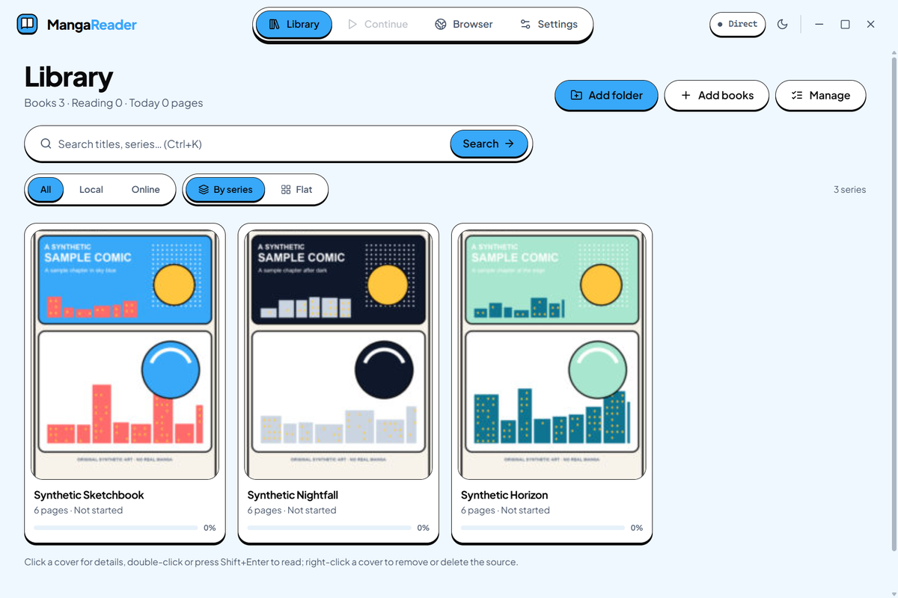
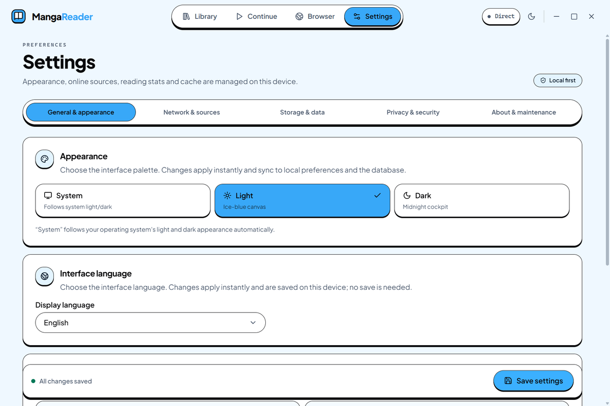
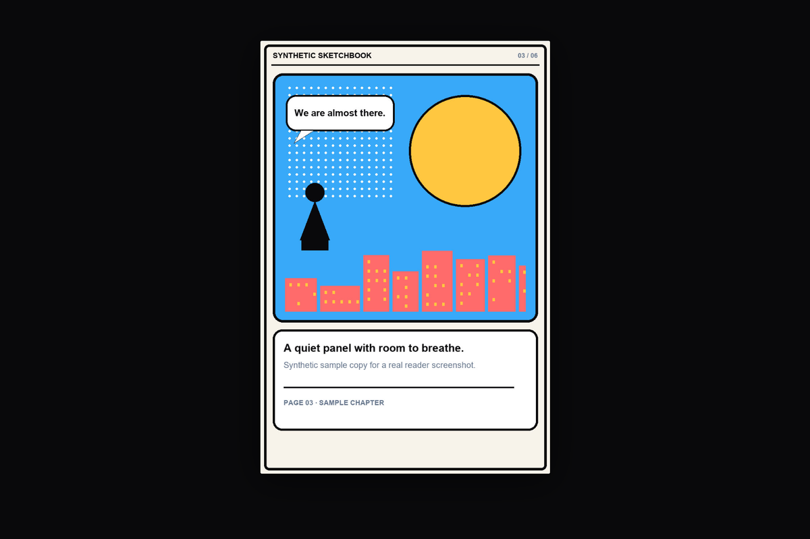

<p align="center">
  
</p>

<h1 align="center">Moyu</h1>

<p align="center">
  <strong>A local-first manga reader for Windows and Linux.</strong><br>
  Moyu is a free desktop application for manga reading and library management.<br>
  Your library stays on your disk. No account, no cloud library, no bundled manga sources.
</p>

<p align="center">
  <a href="https://github.com/D-OneXXX/MR/releases">Download</a>
  ·
  <a href="README.zh-CN.md">简体中文</a>
  ·
  <a href="docs/ARCHITECTURE.md">Architecture</a>
  ·
  <a href="https://github.com/D-OneXXX/MR/issues">Support</a>
</p>

<p align="center">
  
  
</p>

## Product preview

<p align="center">
  
  
</p>
<p align="center">
  
</p>
<p align="center">
  <sub>Screenshots are from the real application, captured with an isolated demo library and original synthetic sample pages. No personal library data is shown.</sub>
</p>

## What it does

- **Library on your disk.** Import folders, ZIP archives, or CBZ files; scan recursively, group
  chapters into series, and search or filter without sending your library anywhere.
- **Read the way you want.** Single-page, double-page, and continuous webtoon modes; RTL/LTR
  direction; zoom and pan; multiple tabs; seamless next-chapter reading.
- **Pick up where you left off.** Reading progress and webtoon scroll position are remembered.
  When a source file moves, relocate it and keep the progress you already made.
- **Natural ordering.** Pages and chapter titles are sorted by number, not by raw filename
  order, so `1, 2, 10` stays in the right order across folders and archive entries.
- **Online reading on your terms.** Open supported JSON manifest or HTML gallery URLs, or
  browse public Telegram channels. Session request headers can be kept in memory only and are
  never written to the library database or logs.
- **A reader built for large images.** Very tall webtoon pages are sliced before rendering so
  they remain usable in a desktop WebView.
- **Local cache and backup.** A configurable disk cache keeps derived images bounded; export a
  `.mrbackup` file to move library metadata, progress, statistics, and preferences to another machine.
- **Six UI languages and two themes.** English, Simplified Chinese, Traditional Chinese,
  Spanish, Japanese, and Korean; light, dark, or follow-system appearance.

## Supported platforms

| Platform | Package | Notes |
|---|---|---|
| **Windows x64** | NSIS installer | Primary platform. `.cbz` / `.zip` file associations and single-instance activation are supported. |
| **Linux x86_64** | `.deb`, `.rpm`, `.AppImage` | Long-term-stability channel for critical security and crash fixes. System package installs do not self-update; the AppImage build can use the in-app updater. |

macOS and ARM64 builds are not part of the current release scope.

## Download

Official builds are distributed through GitHub Releases:

**[Browse releases →](https://github.com/D-OneXXX/MR/releases)**

A release normally provides:

- Windows: an NSIS installer.
- Linux: `.deb`, `.rpm`, and `.AppImage` packages.
- Tauri updater manifests and signatures alongside the packages.

If no public build is listed yet, use the development instructions below to build from source.

## Installation

### Windows

1. Download the NSIS installer from the latest release.
2. Run the installer and choose the installation scope and language.
3. Launch **Moyu**, add a folder or archive, and select a book.

The Windows installer is **not Authenticode-signed**. Windows SmartScreen may show a warning;
verify that the installer came from this repository’s Releases page before running it. Update
packages use a separate Tauri updater signature.

### Linux

- Install the `.deb` or `.rpm` with your distribution’s package manager.
- For the AppImage, make it executable (`chmod +x MangaReader*.AppImage`) and run it.
- System package installs are not replaced in place by the application. Use your package
  manager to install updates; the AppImage build can use the in-app updater.

On Windows, library data lives under `%APPDATA%\com.local.manga-reader` and cache data under
`%LOCALAPPDATA%\com.local.manga-reader`. The exact data and cache locations are shown in
**Settings → Storage & data**. Uninstall through Windows **Settings → Apps** or your Linux
package manager; remove the data directory manually if you also want to delete local library
metadata and progress.

## Name and upgrade compatibility

The application calls itself **Moyu**. For existing installations, the installer product identity,
the `.cbz` / `.zip` file-association registration names, the data directories
(`com.local.manga-reader`), update signatures and endpoints, and some artifact filenames
intentionally keep the legacy **MangaReader** identity so that upgrades, existing file
associations, and existing user data remain intact.

## Quick start

1. Choose **Add folder** or **Add books** and select a folder, ZIP, or CBZ.
2. Open a cover to view details, then double-click or press **Shift+Enter** to start reading.
3. Switch between single-page, double-page, and webtoon layouts from the reader.
4. Use **Settings → General & appearance** to change the theme, interface language, and
   reading preferences.
5. For online reading, use the browser/online entry with a URL you are authorized to access.
   Moyu does not bundle manga sources or subscriptions.

## Configuration

- **Appearance & language** — light, dark, or system theme; six interface languages.
- **Storage & data** — cache usage and budget, backup/export, and cleanup.
- **Network & sources** — proxy mode, online reading controls, and request-header scope.
- **Privacy & security** — local data policy, diagnostics, and safety controls.
- **About & maintenance** — version, build origin, updates, and support links.

Online session headers can be restricted to memory only. They are not written to SQLite, logs,
backup files, or diagnostics.

## FAQ

**Does Moyu upload my library?**

No. The library database, progress, cache, and reading statistics stay on the local machine.
There is no account or cloud sync.

**Which formats are supported?**

Image folders, ZIP, and CBZ. Other archive formats are not part of the current scope.

**Can I move my books after importing them?**

Yes. Use the missing-file relocation flow. Existing progress, webtoon position, and reading
statistics are preserved.

**Where is my data stored?**

On Windows: `%APPDATA%\com.local.manga-reader` for library data and
`%LOCALAPPDATA%\com.local.manga-reader` for cache. The app’s **Storage & data** settings show
the active locations.

**How do updates work?**

Open **Settings → About & maintenance** and check for updates manually. The app does not
silently restart or switch reading modes. Windows follows the regular release channel; Linux
follows the critical-fix channel.

**Why does Windows SmartScreen warn me?**

The Windows installer is not Authenticode-signed. This is separate from the updater signature,
which is verified by the application.

**Does Moyu include manga sources?**

No. You provide local files or URLs you are authorized to access. The project does not bundle
publishers’ catalogs or scanlation feeds.

**How do I uninstall it?**

Use Windows **Settings → Apps** or your Linux package manager. Local data is not removed
automatically; remove the data directory if you want a full cleanup.

## Support

- Bugs and feature requests: [GitHub Issues](https://github.com/D-OneXXX/MR/issues)
- Security reports: [GitHub Security Advisories](https://github.com/D-OneXXX/MR/security/advisories/new)

When reporting a problem, include the app version, operating system, build origin shown in
**About & maintenance**, and the steps to reproduce. Remove personal paths, book titles,
cookies, tokens, and full URLs before posting logs or screenshots.

## License

Moyu is **free for personal and other noncommercial use** under the **PolyForm Noncommercial
License 1.0.0**. The project is source-available; it is not an OSI open-source project.
Commercial use is not granted by this license.

- [LICENSE](LICENSE)
- [NOTICE.md](NOTICE.md) — required notice, build-origin fingerprint, and update channels
- [THIRD_PARTY_NOTICES.md](THIRD_PARTY_NOTICES.md) — bundled font, icon, and dependency notices

## Languages

- English (this file, canonical)
- [简体中文](README.zh-CN.md)

The application UI also includes Traditional Chinese, Spanish, Japanese, and Korean.

## Development

Requirements: Node.js 22+, a stable Rust toolchain, WebView2 on Windows, and the usual
Tauri 2 Linux build dependencies.

```bash
npm install
npm run tauri dev     # Vite on :1420 + the desktop window
npm run build         # version gate + TypeScript + production frontend build
```

```bash
npx tsc --noEmit
cargo test --lib --manifest-path src-tauri/Cargo.toml
node tests/qa/run-qa.mjs --suite=static
```

The QA harness starts the application with isolated data and cache directories. Never point it
at a real library. The full suite is `node tests/qa/run-qa.mjs` (Node.js 22+); `--suite=static` is
the fast guard. The harness isolates the application data directory, the render and online caches,
and the WebView2 profile. See [docs/ARCHITECTURE.md](docs/ARCHITECTURE.md) for the runtime
architecture and where your data lives.

Bug reports and release feedback are welcome in the issue tracker. Security issues should
follow `SECURITY.md`.

---

Moyu is not affiliated with any manga publisher, scanlation group, or online source.
You are responsible for the content you import or access.
