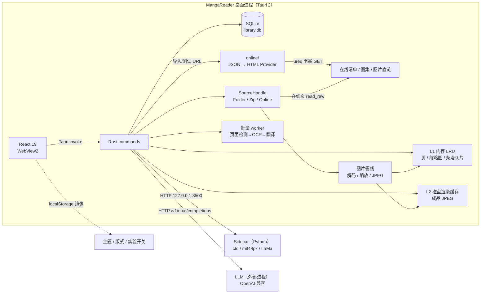
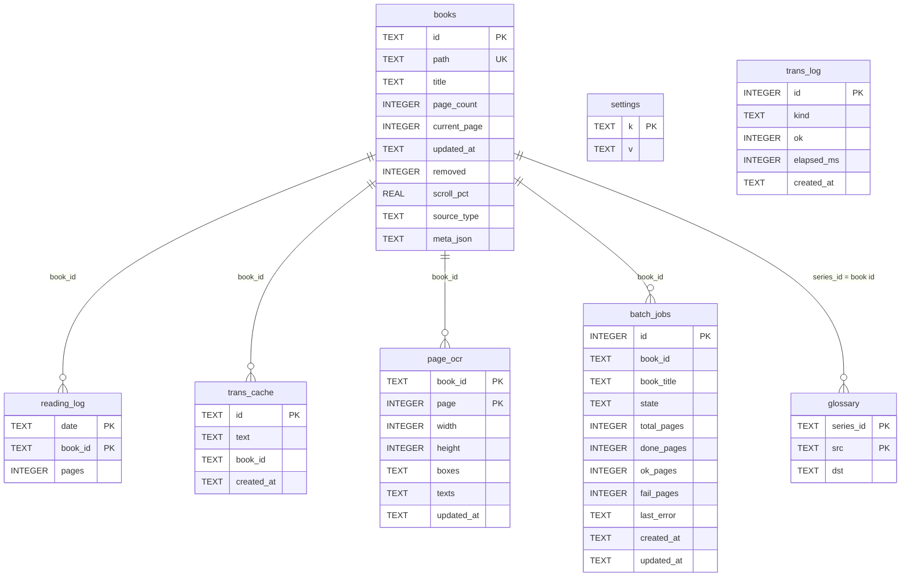
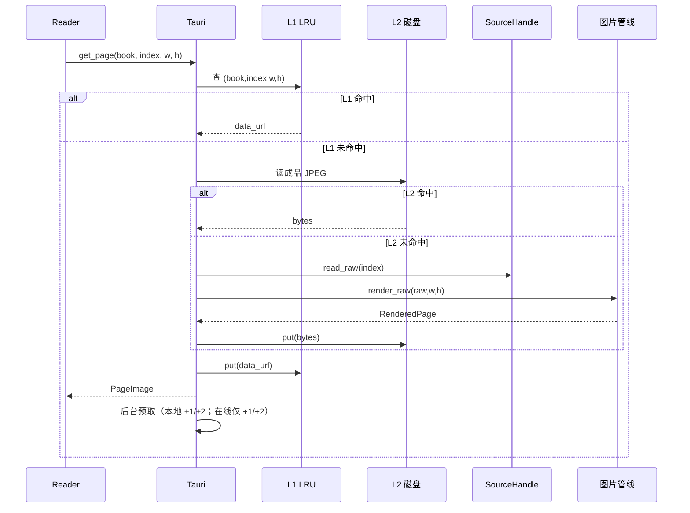
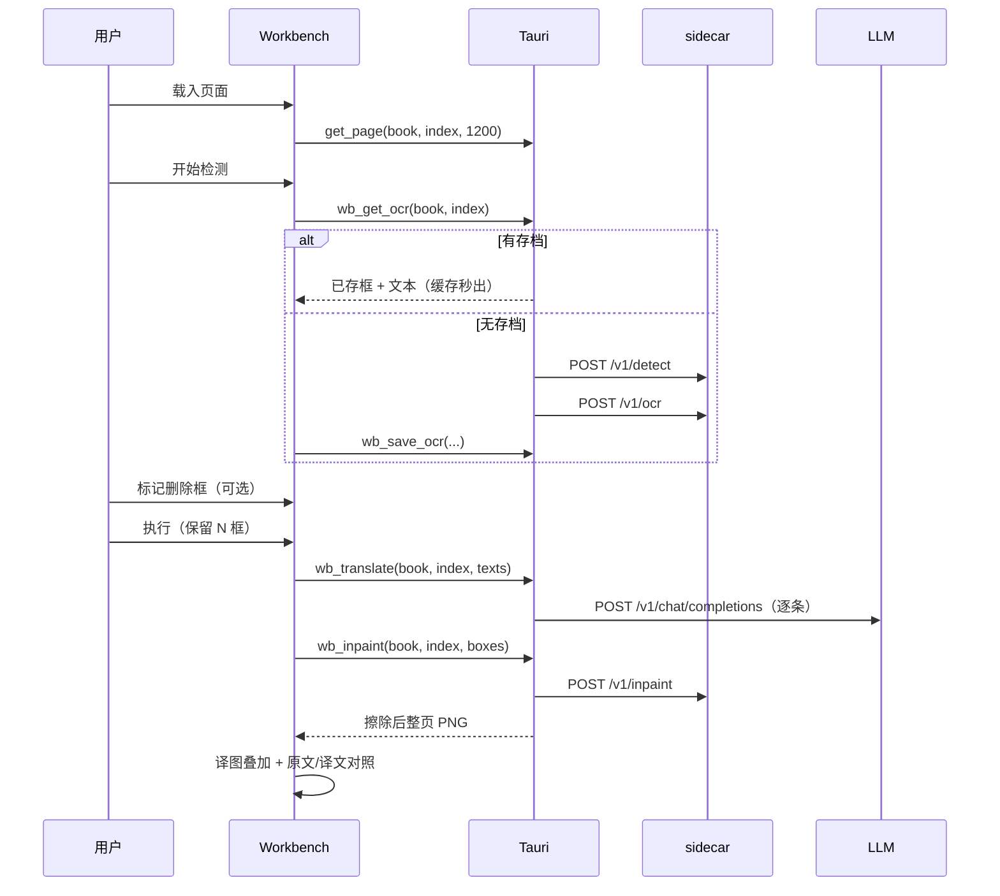
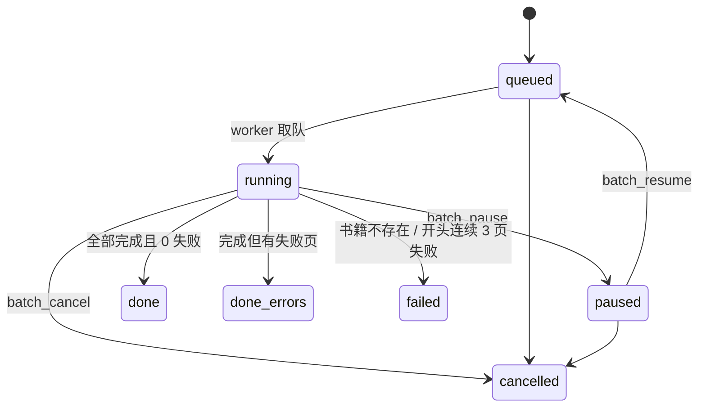

# MangaReader 技术文档

> 适用代码基线：`2a8a248`（2026-10-19）  
> UI 版本：`v0.2.0`（`src/App.tsx`）；npm/Cargo/Tauri 清单版本：`0.1.0`  
> 文档定位：面向接手开发、架构评审与排障的工程说明，不替代用户手册。  
> 相关文档：[README](../README.md)、[Sidecar 接口契约](sidecar-api.md)、[真机冒烟清单](smoke-test.md)、[2026-10-19 冒烟报告](smoke-test-report-2026-10-19.md)、[在线直读设计](../superpowers/specs/2026-10-19-online-direct-reader-design.md)。

## 目录

- [1. 项目定位](#1-项目定位)
- [2. 技术栈](#2-技术栈)
- [3. 系统架构](#3-系统架构)
- [4. 目录结构](#4-目录结构)
- [5. 数据模型](#5-数据模型)
- [6. 后端架构](#6-后端架构)
- [7. 前端架构](#7-前端架构)
- [8. 配置与环境变量](#8-配置与环境变量)
- [9. 开发与运行](#9-开发与运行)
- [10. 测试与验收](#10-测试与验收)
- [11. Sidecar 契约](#11-sidecar-契约)
- [12. 性能设计要点](#12-性能设计要点)
- [13. 已知问题与限制](#13-已知问题与限制)
- [14. 扩展指南](#14-扩展指南)
- [15. 术语表](#15-术语表)
- [附录 A：Tauri 命令契约](#附录-atauri-命令契约)
- [附录 B：常见故障排查](#附录-b常见故障排查)
- [附录 C：文档与代码的维护约定](#附录-c文档与代码的维护约定)

---

## 1. 项目定位

MangaReader 是一个 **local-first 的 Windows 桌面漫画阅读器**：

- 书库、阅读进度、统计、OCR/翻译缓存全部保存在本机；
- 支持图片文件夹、`.zip`、`.cbz`；实验性支持 URL 在线直读（JSON 清单或单页 HTML 直铺图集）；
- 阅读器支持单页 / 双页 / 条漫三种版式，日式右开（RTL）与西式左开（LTR）；
- 集成一条本地 AI 流水线：文本检测（ctd）→ OCR（mit48px）→ 翻译（OpenAI 兼容 LLM）→ 擦除（LaMa）→ 嵌字；
- 提供逐页翻译工作台、整话批量预翻译、术语表、阅读统计看板与服务状态页。

在线直读默认关闭，需在设置 → 实验性功能中开启；已下载页面仍进入本地 L1/L2 缓存，进度与书库记录始终在本机。

### 1.1 设计原则

| 原则 | 落地方式 |
|---|---|
| 本地优先 | SQLite + 本地渲染缓存；侧车模型与 LLM 均在本机回环地址 |
| 流式按需 | 不整包解压、不把整本漫画读入内存；zip 只读命中的单个条目 |
| 预算制内存 | L1 按字节 LRU；长图按显示宽度缩放解码；条漫切片后释放整页栅格 |
| 人机协同翻译 | 检测/OCR 后允许人工删框，再翻译/擦除，避免误擦拟声词 |
| 可回滚的删除 | “移除”为软删（保留进度），与“删除源文件”严格区分 |
| 实验功能门控 | 翻译、条漫、在线直读默认关闭，开启后入口才出现 |
| 在线合规边界 | 只解析用户提供的清单/图集与图片直链；不做站点适配、查看器链路、切条反混淆或自动登录 |

### 1.2 冻结功能池（当前阶段不实现）

来自 [README](../README.md)，进入“打磨/优化”阶段也不允许顺手实现：

- 标签系统（自定义分类/颜色标签）
- 跨设备同步（进度/书库云同步）
- 阅读统计分享（数据页导出/分享卡片）
- 漫画源订阅（自动抓取/RSS/站点插件；手动 URL 直读不在此列，已作为实验功能实现）
- 云端模型（把检测/OCR/擦除/翻译切到云端 API）

---

## 2. 技术栈

### 2.1 前端

| 组件 | 版本/选型 | 说明 |
|---|---|---|
| React | 19.1 | 函数组件、并发渲染 |
| TypeScript | 5.8 | `strict` 类型检查 |
| Vite | 6.3 | 开发端口固定 `1420`，`strictPort: true` |
| React Router | 6.30 | **HashRouter**（`#/reader/:id`），适配本地文件加载 |
| lucide-react | 0.525 | 线性图标 |
| Tauri API | 2.x | `invoke`、window、webview、dialog |

前端无图表库、无状态管理库、无 UI 组件库；图表为手写 CSS/SVG，状态以页面内 `useState` + `localStorage` 镜像为主。

### 2.2 后端

| 组件 | 版本/选型 | 说明 |
|---|---|---|
| Rust | edition 2021，MSRV 1.77 | Tauri 2 后端 |
| tokio | 全特性 | 异步命令；阻塞工作走 `spawn_blocking` |
| rusqlite | 0.31（bundled） | 单文件 SQLite |
| zip | 2 | `.cbz`/`.zip` 随机读条目 |
| image | 0.25（jpeg/png/gif/webp） | 解码/缩放/编码 |
| jpeg-decoder | 0.3 | 长 JPEG 的 IDCT 缩放解码 |
| lru / parking_lot | 0.12 | 字节预算 LRU |
| reqwest | 0.12（rustls） | 访问 sidecar 与 LLM |
| ureq | 2（rustls / socks-proxy） | 在线直读的同步阻塞 HTTP；**不复用** `reqwest` |
| url / percent-encoding | 2 | URL 规范化与文件名百分号解码 |
| regex | 1 | 单页 HTML 图集的 `` 提取 |
| sha2 / hex | 0.10 / 0.4 | 书籍 ID（`sha256(path)`）与清单哈希 |
| windows | 0.62（仅 Windows） | WinRT `Windows.Media.Ocr` |
| sysinfo | 0.31 | 进程内存统计 |

### 2.3 Sidecar

- Python 3.10+，独立 `.venv`；
- `torch` / `torchvision`（默认 CPU 轮子）、`opencv-python`、`numpy`、`pillow`、`einops`、`pyclipper`、`shapely`；
- 标准库 `ThreadingHTTPServer`，监听 `127.0.0.1:8500`；
- 模型：ctd 文本检测、mit48px CTC OCR、LaMa large 512px 擦除；
- 推理代码内联在 `sidecar/vendor/`，运行时不依赖本机 BallonsTranslator。

### 2.4 LLM

- 任意 OpenAI 兼容 `/v1/chat/completions` 服务；
- 开发环境示例为 `llama.cpp` + `Index-Translate-9B.Q4_K_M`，默认 `http://localhost:8080/v1`；
- 应用只负责发请求与解析 `choices[0].message.content`，不内置模型。

---

## 3. 系统架构



在线直读只在开启实验开关后由 `resolve_online_url` 入库；阅读、缩略图、条漫、OCR、工作台与批量都复用现有管线与 L1/L2，只把 `SourceHandle` 的读取分支换成 HTTP 下载。

### 3.1 进程与端口

| 组件 | 运行方式 | 默认地址 | 生命周期 |
|---|---|---|---|
| 桌面应用 | Tauri dev/build | 前端 `localhost:1420`（dev） | 用户启动 |
| Sidecar | `sidecar\launch.bat` | `http://127.0.0.1:8500` | 独立进程，需手动启动 |
| LLM | 用户自行启动（如 `llama-server`） | `http://localhost:8080/v1` | 独立进程，需手动启动 |

Sidecar 只绑定回环地址；LLM 地址可在设置页修改。

### 3.2 本地数据目录

Windows 下由 `dirs::data_local_dir()` 定位：

```text
%LOCALAPPDATA%\com.local.manga-reader\
├── library.db                 # SQLite 书库/设置/缓存元数据
├── logs\app.log               # 轻量错误日志（追加写）
├── render_cache\              # L2 成品 JPEG，按 book_id 分目录
│   └── <sha256(book_path)>\
│       ├── 000000@800x1200.jpg
│       └── 000003t00@640.jpg  # 条漫切片
└── EBWebView\                 # WebView2 运行时数据
```

- `MR_DATA_DIR` 可覆盖整个数据根目录（SQLite / logs / 默认 render_cache），用于测试与冒烟隔离；未设置时使用系统本地数据目录。
- `MR_RENDER_CACHE_DIR` 可单独覆盖 `render_cache` 根目录（测试隔离用）。
- Sidecar 模型目录默认 `sidecar/models`，可用 `SIDECAR_MODELS` 覆盖。

### 3.3 启动顺序（`src-tauri/src/lib.rs`）

1. 创建 `Arc<AppState>`（设置、DB slot、HTTP client、缓存、源句柄池、条漫布局缓存）。
2. `init_app`：
   - 定位数据目录并创建；
   - 打开 `library.db`，执行 `init_schema` 与迁移；
   - 初始化 `logs/app.log`；
   - 从 `settings` 表回填内存设置；
   - 按 `cache_budget_mb` 设置 L1 预算；
   - 把 SQLite 连接放入 `DbSlot`。
3. 启动常驻批量 worker（2.5s 空转轮询）。
4. 后台线程执行磁盘渲染缓存 trim（≤2GB）。
5. 前端加载 `getSettings` / `listBooks` / `getDashboard`。

---

## 4. 目录结构

```text
manga-reader-tauri/
├── src/                          # React 前端
│   ├── main.tsx                  # HashRouter、主题迁移
│   ├── App.tsx                   # 壳：图标轨 + 路由 + 实验开关守卫
│   ├── lib/tauri.ts              # 冻结的 invoke 契约 + 设置镜像
│   ├── pages/
│   │   ├── Library.tsx           # 封面流、导入、移除/删除、详情 sheet
│   │   ├── Reader.tsx            # 单/双页阅读器 + 选区翻译 + 条漫入口
│   │   ├── Workbench.tsx         # 两步翻译工作台 + 批量队列 + 术语表
│   │   ├── DataView.tsx          # 数据看板
│   │   ├── Glossary.tsx          # 术语表独立页
│   │   ├── Status.tsx            # 服务状态
│   │   └── Settings.tsx          # 主题/实验/缓存/扫描/翻译/统计
│   ├── components/
│   │   ├── Reader/Webtoon.tsx    # 条漫虚拟化滚动 + 后台预切
│   │   ├── Reader/spread.ts      # 单双页与 RTL/LTR 纯函数
│   │   ├── Reader/region.ts      # 选区归一化纯函数
│   │   ├── Reader/shortcuts.ts   # 快捷键单一数据源
│   │   ├── DetailSheet.tsx       # 右侧滑出详情 + shared-element
│   │   ├── BookCard.tsx          # 封面卡片（在线书显示 URL 徽标）
│   │   ├── OnlineImportDialog.tsx# URL 直读：测试 / 仅入库 / 解析并阅读
│   │   └── ...
│   ├── theme.css                 # 设计 token（深浅色）
│   └── components/ui.css         # 通用组件样式
├── src-tauri/
│   ├── src/
│   │   ├── lib.rs                # 数据契约、Settings、启动、命令注册
│   │   ├── commands.rs           # 书库/阅读/缓存/OCR/翻译/统计/术语表
│   │   ├── db.rs                 # SQLite schema、迁移、CRUD
│   │   ├── source.rs             # 文件夹/zip/在线统一图片源与常开句柄
│   │   ├── online/
│   │   │   ├── mod.rs            # URL 规范化、resolve 调度、元数据、信号量
│   │   │   ├── http.rs           # ureq 阻塞传输、代理、请求头、重试、大小上限
│   │   │   ├── direct.rs         # JSON 清单解析与哈希
│   │   │   └── html.rs           # 单页 HTML 直铺图集解析
│   │   ├── pipeline.rs           # 解码/缩放/JPEG/长图/条漫切片
│   │   ├── cache.rs              # L1 字节预算 LRU
│   │   ├── render_cache.rs       # L2 磁盘缓存与 2GB trim
│   │   ├── state.rs              # AppState、句柄池、预取标记
│   │   ├── sidecar.rs            # sidecar HTTP 客户端
│   │   ├── workbench.rs          # 工作台命令、翻译缓存、页 OCR 存档
│   │   ├── batch.rs              # 批量预翻译队列
│   │   ├── ocr.rs                # 裁剪/PNG/WinRT/HTTP OCR
│   │   ├── translate.rs          # OpenAI 兼容请求
│   │   └── logging.rs            # app.log
│   ├── tests/
│   │   ├── e2e_stage1.rs         # 5 页 CBZ 全链路
│   │   └── memory_budget.rs      # 200 页内存验收
│   ├── capabilities/default.json # 窗口/对话框/opener 权限
│   └── tauri.conf.json
├── sidecar/
│   ├── server.py                 # HTTP 服务与路由
│   ├── pipeline.py               # 模型懒加载与推理
│   ├── download_models.py        # 下载/解压模型
│   ├── setup.bat / launch.bat
│   ├── smoke_test.py             # 合成图直驱 pipeline
│   ├── models/                   # 不入库（.gitignore）
│   └── vendor/                   # 内联上游推理代码
├── scripts/
│   ├── verify-spread.mjs         # 单双页/RTL 纯函数验收
│   └── verify-region.mjs         # 选区纯函数验收
├── docs/                         # 接口契约、设计记录、冒烟报告
└── dist/                         # Vite 构建产物
```

---

## 5. 数据模型

SQLite 单文件，无外键约束；级联清理由应用层完成。



### 5.1 表说明

| 表/字段 | 作用 | 关键约束/约定 |
|---|---|---|
| `books` | 书库条目 | `id = sha256(path)`；`path` 唯一（本地为绝对路径，在线为规范化清单/图集 URL）；`removed=1` 为软删；`scroll_pct=-1` 表示无条漫记录 |
| `books.source_type` | 来源类型 | `local` / `generic_manga`（本阶段在线书）/ `anime`（预留，命令不写入）；旧库默认 `local` |
| `books.meta_json` | 在线书派生元数据 | 默认 `{}`；`{schema, manifestHash, fetchedAt, pages:[{url,width?,height?}]}`；`pages[].url` 为完整页面 URL（含 query，下载所需）；**不含** 请求头/Cookie/账号/代理凭据，也不通过 `BookInfo` 暴露 |
| `reading_log` | 逐日逐书阅读页数 | 主键 `(date, book_id)`；只累计“前进页数”，回翻不扣减；迁移旧数据时 `book_id=''` |
| `settings` | 设置键值 | `k/v` 文本；启动时 `hydrate_settings` 回读 |
| `trans_log` | OCR/翻译调用日志 | 保留最近 5000 条；统计取最近 50 条明细 |
| `trans_cache` | 翻译结果缓存 | `id = sha256(book_id|page|原文|目标语言)` |
| `glossary` | 术语表 | 主键 `(series_id, src)`；当前 `series_id = book_id` |
| `page_ocr` | 页级检测/OCR 存档 | 主键 `(book_id, page)`；`boxes/texts` 为 JSON 字符串；批量与工作台共用 |
| `batch_jobs` | 批量预翻译任务 | 状态：`queued/running/paused/done/done_errors/failed/cancelled` |

### 5.2 迁移

`db::init_schema` 幂等，包含：

1. `reading_log` 旧形状 `(date PK, pages)` → `(date, book_id) PK`，旧数据归入 `book_id=''`；
2. `books` 增加 `removed`、`scroll_pct`；
3. `books` 增加 `source_type TEXT NOT NULL DEFAULT 'local'`、`meta_json TEXT NOT NULL DEFAULT '{}'`（旧行自动成为本地书）；
4. `trans_cache` 增加 `book_id`（便于删除书籍时级联清理）。

新增列一律走“检测列是否存在 → `ALTER TABLE ADD COLUMN`”，兼容已有用户库。

### 5.3 关键不变量

- **书籍 ID 稳定**：由本地绝对路径或在线规范化 URL（`books.path`）的 SHA-256 得到；同一路径重导入保留进度。
- **移除 ≠ 删除**：
  - 移除：`removed=1`，源文件/远程源与进度保留；重导入/重扫描自动恢复；
  - 删除源文件：先删除文件/目录，成功后才级联清理 DB 记录与缓存；
  - 在线书“彻底移除”：跳过文件系统，`deleted_files=0`，**不触碰远程源**，只硬删 DB 记录、缓存与句柄。
- **在线元数据不外泄**：`pages` 只含完整页面 URL 与可选宽高；另有 `schema`/`manifestHash`/`fetchedAt`；不含请求头/凭据。`BookInfo` 只增加 `sourceType`、`webtoonReady`，不返回页面 URL、请求头或凭据。
- **在线书条漫可用性**：`sourceType='local'` 恒为 `webtoonReady=true`；在线书要求全部页面具有正数宽高，否则 `false`（HTML 图集恒为 `false`）。
- **阅读统计只增**：`set_progress` 只在 `page > prev` 时累加当日页数。
- **页 OCR 先存后翻**：工作台步骤一成功即 `wb_save_ocr`；批量 worker 也先存 `page_ocr` 再翻译。
- **翻译缓存键包含页码与目标语言**：同页同原文只命中同语言缓存。
- **批量任务幂等**：同一本书已有 `queued/running/paused` 任务时，`batch_enqueue` 返回现有任务。
- **删除书籍级联**：内存 LRU、磁盘渲染缓存、条漫布局缓存、`page_ocr`、`trans_cache`、`batch_jobs`、`reading_log` 全部清理。

---

## 6. 后端架构

### 6.1 数据契约与设置

所有 Tauri 命令返回 camelCase JSON（Rust `#[serde(rename_all = "camelCase")]`）。前端契约集中在 `src/lib/tauri.ts`，Rust 契约集中在 `src-tauri/src/lib.rs`，两处必须同步。

`Settings` 默认值：

| 字段 | 默认值 | 作用 |
|---|---|---|
| `theme` | `dark` | 深/浅色主题 |
| `cacheBudgetMb` | `128` | L1 页/缩略图各自预算（MB） |
| `libraryDir` | `""` | 设置页“扫描目录”的默认路径 |
| `transEndpoint` | `http://localhost:8080/v1` | OpenAI 兼容 Endpoint |
| `transApiKey` | `""` | Bearer Token，可留空 |
| `transModel` | `""` | **为空时翻译直接报错** |
| `transTemp` | `0` | 采样温度 |
| `transTimeoutS` | `30` | 单条翻译超时 |
| `ocrEndpoint` | `""` | 为空走 Windows 本地 OCR；否则走 HTTP OCR |
| `ocrTimeoutS` | `30` | OCR 超时 |
| `srcLang` / `dstLang` | `ja` / `zh` | 翻译语言对 |
| `experimentalTrans` | `false` | 翻译功能总开关 |
| `experimentalWebtoon` | `false` | 条漫模式开关 |
| `sidecarEndpoint` | `http://127.0.0.1:8500` | 检测/OCR/擦除服务 |
| `sidecarTimeoutS` | `120` | sidecar 超时 |
| `wbDetector` | `ctd` | 工作台检测器槽位 |
| `wbOcr` | `mit48pxctc` | 工作台 OCR 槽位 |
| `wbInpaint` | `lama_large_512px` | 工作台擦除槽位 |
| `experimentalOnline` | `false` | 在线 URL 直读总开关（镜像 `mr-exp-online`） |
| `onlineProxy` | `""` | 在线源代理；空=直连，支持 `http/https/socks5`，拒绝内嵌凭据 |
| `onlineConcurrency` | `3` | 单本在线书页面下载并发，保存时钳制 1–8 |
| `onlineHeaders` | `""` | 手动请求头：JSON 对象或单行 Cookie；明文保存 |

持久化：`set_settings` 将全部字段写入 `settings` 表，并即时调整 L1 预算；`trans_api_key`、`onlineHeaders` 均以明文形式存于 SQLite。`onlineProxy` 与 `onlineHeaders` 在保存时校验（代理 scheme/主机/凭据；请求头名称/CRLF/禁止头）；`onlineProxy`、`onlineConcurrency` 或 `onlineHeaders` 变化时清空 `AppState.sources` 常开池，让新配置立即生效。

### 6.2 命令分层

完整命令清单见 [附录 A](#附录-atauri-命令契约)。按职责分组：

- **书库**：`scan_library`、`import_books`、`remove_books`、`list_books`、`get_book`；
- **在线源**：`resolve_online_url`、`test_online_connection`（均受 `experimentalOnline` 门控）；
- **阅读**：`list_entries`、`get_page`、`get_thumbnail`、`set_progress`、`clear_pages`；
- **条漫**：`get_webtoon_layout`、`get_webtoon_tile`；
- **统计**：`get_memory_stats`、`get_dashboard`、`get_reading_log`、`get_reading_by_book`；
- **缓存**：`clear_thumbnail_cache`；
- **设置**：`get_settings`、`set_settings`；
- **OCR/翻译**：`ocr_region`、`translate_region`、`get_trans_stats`、`sidecar_health`；
- **术语表**：`glossary_list`、`glossary_set`、`glossary_remove`；
- **工作台**：`wb_detect`、`wb_ocr`、`wb_inpaint`、`wb_translate`、`wb_save_ocr`、`wb_get_ocr`；
- **批量队列**：`batch_enqueue`、`batch_pause`、`batch_resume`、`batch_cancel`、`batch_list`。

### 6.3 图片源（`source.rs`）

统一接口：

```rust
trait ImageSource {
    fn page_count(&self) -> Result<usize, BackendError>;
    fn entry_names(&self) -> Result<Vec<String>, BackendError>;
    fn read_raw(&self, index: usize) -> Result<RawPage, BackendError>;
}
```

- `FolderSource`：扫描目录下图片扩展名（jpg/jpeg/png/gif/webp），按文件名排序；
- `ZipSource`：列出归档内图片名并排序；每次读取重新打开归档，只解压命中的单条目；
- `OnlineSource`：页列表来自 `meta_json.pages`；`read_raw` 用 `ureq` 阻塞 GET（≤32MiB、状态码 + 图片魔数校验、自动携带 `Referer`/`Origin`），每本书一个阻塞信号量限制并发（1–8）；`entry_names` 取 URL 文件名（百分号解码）或“第 N 页”；
- `source_handle_for_book`：按 `source_type` 统一打开本地/在线源；`generic_manga` 用 `onlineProxy` + `onlineHeaders` 构造 `UreqTransport` 与 `OnlineSource`，`anime` 返回“预留未实现”；
- `SourceHandle`：热路径常开句柄池（最多 16 本；超限整体清空重开），zip 中央目录只解析一次；
- `read_partial`：只读条目前 256KB 用于条漫 header 尺寸解析，失败回退全读；在线源直接返回“在线源不支持 header 探测”，在线条漫布局分支不调用它；
- ZipSlip 防护：`entry.enclosed_name()` 校验条目名。

### 6.4 图片管线（`pipeline.rs`）

`render_raw(raw, max_w, max_h)`：

1. 依扩展名选格式，无扩展名嗅探魔数；
2. 读取源尺寸；
3. 若源高 > `TALL_IMAGE_H=8000` 且为 JPEG 且请求了 `max_w`：走 `jpeg-decoder` 的 IDCT 缩放解码，避免全分辨率栅格；
4. 否则常规解码后 `Triangle` 滤镜等比缩小（不放大）；
5. 统一转 RGB、JPEG 质量 **82**、base64 dataURL，同时返回 `bytes` 供 L2 落盘。

条漫：`render_webtoon_tiles(raw, max_w)` 一次解码、一次 RGB 转换、按 `WEBTOON_TILE_H=2048` 均分切片，每片 JPEG 质量 **80**；切片数前后端共用公式。

### 6.5 三级缓存

```text
L1 内存 LRU（ImageCache）
  ├─ page_cache:  (book, index, req_w, req_h) → RenderedPage(data_url)
  ├─ thumb_cache: book → RenderedPage(data_url)
  └─ tile_cache:  (book, index, tile, render_w) → RenderedPage(data_url)

L2 磁盘成品 JPEG（RenderCache）
  ├─ <book>/000003@800x1200.jpg
  └─ <book>/000003t00@640.jpg

L3 源 + 管线
  └─ Folder/Zip/Online → 解码 → 缩放 → JPEG
```

- L1 只驻留 `data_url`，`bytes` 在 `put` 入口剥离（权威副本在 L2）；
- 默认预算：页 128MB + 缩略图 128MB（同一设置滑杆），条漫切片固定 48MB；
- L2 总预算 **2GB**，启动时 trim，累计写入 >256MB 后后台再 trim；
- L2 文件名包含请求尺寸，避免不同视口尺寸互相污染；
- 删除书籍时同步清 L1/L2/条漫布局；
- 阅读器退出（`clear_pages`）清空页 LRU 与切片 LRU，保留缩略图。

### 6.6 取页与预取



- 后端在主请求落地后异步预取：本地 ±1/±2；在线仅 **+1/+2**（不回读历史页）；
- 前端在阅读器空闲时再预取：本地当前页 ±3；在线仅当前页起 +2（`requestIdleCallback`，250ms 超时兜底）；
- 前端 `requestedRef` 去重请求；页滑出窗口时释放 dataURL 与请求 key，防止回翻卡死；
- 在线页 L2 命中时不发网络请求，断网仍可回翻已缓存页；未缓存页返回网络错误。

### 6.7 OCR（`ocr.rs` + `commands.rs`）

框选 OCR（阅读器）：

1. 前端传相对矩形 `RegionRect{x,y,w,h}`（0..1，相对原图）；
2. 后端读取**原图**（非展示缩放图），按相对坐标裁剪；在线书通过同一 `source_handle_for_book` 下载原图（不走 L2，未缓存时会再次请求网络）；
3. 宽或高 <4px 视为误触；
4. `ocrEndpoint` 为空 → WinRT `Windows.Media.Ocr`（需系统语言包，单边超限先降采样）；
5. 非空 → `POST <ocrEndpoint>`，请求 `{"image": "<base64 png>"}`，响应要求 `{"text": "..."}`；
6. 成功/失败写 `trans_log(kind='ocr')`。

工作台 OCR 槽位：

- `mit48pxctc` → `POST /v1/ocr`，整页 PNG + 框数组；
- `windows` / `http` → 对每个框换算相对坐标，逐框调用 `ocr_region`。

> 注意：工作台 OCR 目前不写 `trans_log`，设置页 OCR 统计只覆盖阅读器选区 OCR（见 [已知问题](#13-已知问题与限制)）。

### 6.8 翻译（`translate.rs` + `workbench.rs`）

- Endpoint 拼接：`{transEndpoint}/chat/completions`；
- 请求体：`model`、`temperature`、`system`、`user`；
- `transApiKey` 非空才带 `Authorization: Bearer`；
- 超时：`transTimeoutS`（默认 30s）；
- 响应取 `choices[0].message.content`；
- 工作台 system prompt 会注入术语表：

```text
你是漫画翻译引擎。把用户文本从 ja 翻译成 zh，只输出译文，不要解释，不要引号。
术语表(必须严格遵守):
<src>=<dst>
...
```

- 翻译缓存键：`sha256(book_id | page | trim(text) | dst_lang)`；
- 同一页内重复文本去重；每条未命中文本串行请求 LLM，成功后写 `trans_cache`；
- 工作台/批量翻译成功写 `trans_log(kind='trans')`，耗时覆盖整页翻译。

### 6.9 工作台流程（`wb_*`）



约束：

- 原图永不修改；被删除的框不翻译、不擦除；
- `wb_detect` / `wb_ocr` / `wb_inpaint` 各自重新读取原图并编码 PNG；在线书每次都会重新下载原图（不走 L2），OCR/工作台因此可能产生额外网络请求；
- 页 OCR 存档是“翻过的页秒出”的基础；
- 擦除结果目前**不缓存**，每次执行都会重新请求 sidecar（见已知问题）。

### 6.10 批量预翻译（`batch.rs`）



- 常驻 worker 每 2.5s 轮询 `queued`，FIFO 取任务；
- 每页处理前重读任务状态，暂停/取消即时生效（当前页会跑完）；
- 每页流程：
  1. 查 `page_ocr`；有存档 → 直接取文本；
  2. 无存档 → `load_page_png` → sidecar detect → OCR → 写 `page_ocr`；`load_page_png` 对本地/在线统一按 bookId 取源，在线页重新下载原图并受并发信号量限制；
  3. 文本非空 → `translate_texts_cached`（翻译缓存 + 术语表）；
- 更新 `done/ok/fail/last_error`；
- 开头连续 3 页全失败且成功数为 0 → 任务 `failed`，避免空转数百页；
- 每页后 `sleep 30ms` 让出运行时；
- 续跑/重跑只补未完成页与未命中翻译。

### 6.11 错误与日志

- 统一错误 `BackendError`：IO / Zip / Decode / Db / Network / Msg，最终 `to_string()` 给前端；
- 页面获取失败会写 `logs/app.log`，含书名、页码、原因；在线请求另记 `online_page` / `online_meta` scope，只记页码、状态码与 scheme/host/path，不记录 query/fragment；日志不包含 `onlineHeaders`/凭据；
- 前端统一 `toastErr(command, error)` 展示可读错误；
- 日志/缓存失败静默降级，不拖垮主流程。

### 6.12 在线直读（`online/`）

**范围与边界**

- 实验功能，`experimentalOnline` 默认 `false`；关闭时 `resolve_online_url` / `test_online_connection` 返回“在线直读未开启”，已入库在线书仍可阅读；
- 只支持两类输入：**JSON 清单**；正文不是合法 JSON 时回退**单页 HTML 直铺图集**（只提取当前页面 ``）。合法 JSON 但清单语义错误（版本、页数、页 URL 非法等）直接返回清单错误，不再回退 HTML；
- 明确不支持：EH/ExHentai/JMComic 站点适配、`/g/`、`/s/` 等分页查看器链路、主图推断、图片切条反混淆（`slice_aid`/MD5）、自动登录/Cookie jar/验证码/反爬/JS 渲染；OPDS / Komga / Kavita 推迟到 1.1；
- 允许私网/回环地址（自建源）；清单 URL、页面 URL 与代理均为用户显式输入。

**同步 `ImageSource` + 阻塞 HTTP**

- `OnlineSource` 实现现有同步 `ImageSource`，构造只发生在 `spawn_blocking` 内；`UreqTransport` 为纯阻塞实现，不依赖 Tokio runtime；
- 页下载使用 `ureq`（rustls；`http/https` 走 CONNECT，`socks5://` 走 SOCKS5），连接超时 10s、总超时 30s，固定 UA `MangaReader/0.1 online-direct`；
- 重定向最多 5 跳，最终 URL 复验 `http/https`，并拒绝含 userinfo 或超过 2048 字节的目标；跨 origin（scheme+host+port）重定向丢弃**全部手动请求头**（Cookie/Authorization/自定义头），只保留由页面派生的 Referer/Origin；同 origin 重定向保留全部手动请求头；408/429/500/502/503/504 最多重试 2 次（500ms/1500ms，`Retry-After` ≤5s），其余 4xx 不重试；
- 响应上限：清单/HTML 2MiB，单页 32MiB；页面必须有 2xx 状态并以 `image::guess_format` 魔数验证，HTML/JSON/文本不进入图片解码；
- HTTP/传输失败映射为 `BackendError::Network`；URL/清单/HTML 解析错误为 `BackendError::Msg`，前端以字符串展示。

**身份与元数据**

- `books.path` = 规范化清单/图集 URL（trim、仅 http/https、拒绝 userinfo、去 fragment、保留 query，≤2048 字节）；
- `book.id = sha256(path)`；`source_type='generic_manga'`；
- `meta_json = {schema:1, manifestHash, fetchedAt, pages:[{url,width?,height?}]}`；页顺序即阅读顺序；`pages[].url` 保存完整页面 URL（含 query，下载所需）；宽高必须同时为正数才保存；不含任何请求头/凭据；
- `manifestHash = sha256(serde_json(规范化 {title, pages}))`，`fetchedAt` 不参与哈希。

**JSON 清单**

| 字段 | 规则 |
|---|---|
| `version` | 可选，出现时必须为 `1` |
| `title` | 可选，trim 后 ≤200 字符；空则从 URL 路径推导（无则 host） |
| `pages` | 必填，1–5000 项；字符串或 `{url,width,height}` 对象 |
| 页面 `url` | 绝对 `http/https`、无 userinfo、≤2048 字节；任一页非法则**整份拒绝** |

**单页 HTML 图集（回退）**

- 仅解析当前这一个 HTML 页面，不跟随分页链接、不执行脚本；标题取 `<title>`（去标签/常见实体，≤200 字符），缺失时从重定向后的最终 URL 推导；
- `` 按 `data-src` → `data-original` → `src` 取第一个非空地址；属性值先解码常见 HTML 实体（单次，`&amp;` 最后）再按**重定向后的最终 URL** `join`；跳过 `data:`/`blob:`/`javascript:` 与非法 URL；按出现顺序去重；1–5000 张；
- 不推断主图；没有可用图片时报“未找到可读图片；分页查看器或依赖 JS 的页面不在支持范围”；
- HTML 无法提供可靠宽高，`webtoonReady=false`，只支持单/双页。

**导入 / 刷新（`resolve_online_url`）**

1. 校验开关、URL、代理与 `onlineHeaders`；`blocking` 中只拉取一次，先 JSON，正文不是合法 JSON 时才尝试 HTML；
2. 0 页拒绝入库；
3. 同 `book.id` 已存在 → `removed=0`、更新标题/页数/`meta_json`/`updated_at`，保留 `current_page` 与 `scroll_pct`，并按新页数钳制进度；
4. 清单哈希**未变** → 幂等更新，不失效缓存；
5. 清单哈希**变化**：
   - 该书存在 `queued/running/paused` 批量任务 → 拒绝并提示先取消；
   - 同一事务内清 `page_ocr`、`trans_cache`；提交后清 L1、L2、条漫布局缓存与常开句柄池；
   - 保留 `reading_log`；
6. `test_online_connection` 只解析、不写库，返回 `{ok,title,pageCount,elapsedMs,message}`；代理/请求头来自当前设置，不使用页面并发信号量。

**阅读与缓存**

- `get_page` / `get_thumbnail` / `get_webtoon_tile` / `list_entries` / `ocr_region` / `wb_*` / `batch` 都通过 `source_handle_for_book`；在线页下载后与本地页共用管线、L1/L2、页 OCR、翻译缓存与批量任务表；
- L1/L2 命中不联网；缩略图实际取第 1 页，L2 键 `(book,0,edge,edge)`，失败不阻塞书库列表；
- 每本在线书一个阻塞信号量，`onlineConcurrency`（默认 3，1–8）覆盖主请求、预取、OCR、工作台与批量；
- 后端预取仅 +1/+2，前端 idle 预取仅当前页起 +2；不回读历史页；
- `list_entries` 在线书由 `meta_json` 生成页名，不联网；
- 条漫：`get_webtoon_layout` 在线分支只读 `meta_json` 宽高，不联网；任一页缺宽高返回“该在线书籍缺少页面尺寸，无法使用条漫模式”；`webtoonReady=false` 时前端禁用按钮与自动建议，后端仍兜底报错；
- 在线页的展示缓存是“按视口渲染后的 JPEG”；选区 OCR、工作台、批量读取原图时会重新下载（不走 L2），见[已知问题](#13-已知问题与限制)。

**请求头与隐私**

- `onlineHeaders` 为空不附加；以 `{` 开头按 JSON 对象解析，否则视为单行 Cookie；拒绝 CR/LF 与 `Host`、`Content-Length`、`Connection`、`Transfer-Encoding`；
- 图片请求自动附加 `Referer: <规范化页面 URL>` 与 `Origin: <scheme://host>`；同 origin 请求（含首跳与同源重定向）中用户显式配置的同名头优先；跨 origin 重定向丢弃全部用户请求头后改用派生值；
- 明文保存在本机 SQLite，不读取浏览器 Cookie，不做自动登录或全局 Cookie jar；`meta_json.pages[].url` 保存完整页面 URL（含 query，下载所需），但 `app.log` 只记 scheme/host/path、不含 query/fragment；`meta_json` 与日志均不含 `onlineHeaders`/凭据。

**删除**

- “移除”只置 `removed=1`；重新导入同一 URL 恢复；
- “彻底移除”对在线书跳过文件系统删除（`deleted_files=0`），级联清 `reading_log`、`page_ocr`、`trans_cache`、`batch_jobs`、L1/L2/条漫布局/句柄，远程源文件不动。

**扩展点**

`online::resolve` 固定“一次拉取 → JSON → HTML”的调度；未来 OPDS/Komga/Kavita Provider（1.1）可在 scheme/host 层增加匹配，不需要改阅读器与缓存链路。本阶段没有 EH/JM 站点适配器。

---

## 7. 前端架构

### 7.1 入口与路由

- `main.tsx`：HashRouter、深色默认、一次性 `mr-theme-v2` 迁移；
- `App.tsx`：
  - 阅读器路由 `/reader/:id` 走**无壳全屏**；
  - 其余路由走 `TitleBar + 左侧图标轨 + 主内容`；
  - 实验性翻译关闭时，`/workbench`、`/glossary` 显示“实验性功能未开启”守卫页；
  - 所有路由包 `.view-fade`（260ms 淡入）。

路由表：

| 路由 | 页面 | 说明 |
|---|---|---|
| `/` | `Library` | 封面流、导入、URL 直读、移除/删除、详情 sheet |
| `/reader/:id` | `Reader` | 全屏沉浸阅读器 |
| `/data` | `DataView` | 统计看板 |
| `/workbench` | `Workbench` | 翻译工作台（需实验开关） |
| `/glossary` | `Glossary` | 术语表（需实验开关） |
| `/status` | `Status` | sidecar/LLM/内存状态 |
| `/settings` | `Settings` | 全部设置 |
| `*` | `Library` | 兜底 |

### 7.2 页面职责

| 页面 | 关键行为 |
|---|---|
| Library | 搜索防抖 250ms；文件/文件夹导入；全窗口拖放；单击封面打开 `DetailSheet`；双击进阅读器；多选移除/删除；批量任务横条 3s 轮询；实验开关开启时显示「URL 直读」按钮与 `OnlineImportDialog`（测试/仅加入书库/解析并阅读）；在线书显示 URL 徽标、「彻底移除…」与不删远程源的确认文案 |
| Reader | 单/双页/条漫；缩放 0.5–4；拖拽平移；双击重置；目录；阅读设置；快捷键；选区 OCR/翻译；3s 控制条自动隐藏；进度 500ms 防抖保存；`webtoonReady=false` 时禁用条漫按钮与自动建议；在线书 idle 预取只从当前页 +2 |
| Workbench | 四个 provider 下拉；sidecar 健康；载入页面；检测+OCR；删框；翻译+擦除+嵌字；批量队列；术语表；2s 任务轮询；在线书按 bookId 下载原图 |
| DataView | 四格统计、Top3、26 周热力图、近 14 天堆叠趋势；无图表库 |
| Glossary | 按书维护术语；重复原文覆盖；删除二次确认 |
| Status | 只读展示 sidecar 健康、翻译服务、调用统计、内存/缓存；在线直读卡片展示开关、代理是否配置、并发数（不回显请求头） |
| Settings | 主题、实验开关（翻译/条漫/在线直读，即时持久化）、缓存预算、扫描目录、翻译服务、在线源与网络（代理/并发/请求头/测试 URL）、统计、快捷键表 |

### 7.3 阅读器

#### 版式与翻页

- `PageMode = "single" | "double" | "webtoon"`；
- `Direction = "rtl" | "ltr"`，默认 RTL；
- `spreadFor(p, n, mode, dir)` 返回视觉左→右的页索引：
  - 单页：`[p]`；
  - LTR 双页：偶数页为左页；
  - RTL 双页：第 0 页作为封面单独居右，之后成对且“较早页在右”；
- `stepPage` 按版式跨 1/2 页推进；`isSoloCover` 处理 RTL 封面单页；
- 版式按书记忆在 `localStorage`：`mr-wt-<bookId>`；全局偏好 `mr-reader-mode` / `mr-reader-dir`。

#### 图片请求尺寸

- 目标尺寸 = 画布尺寸 × DPR × 缩放 boost（zoom>1.25 时最多 2×）；
- 按 64px 桶取整，单边上限 **1920**；
- 双页时宽度按页数均分；
- 缩放/resize 稳定 250–400ms 后触发静默高清升级，旧图保留到新图到达。

#### 交互

- Ctrl/Cmd + 滚轮：以光标为中心缩放；
- 双指 pinch：以两指中点缩放并平移；
- 单指拖拽：zoom>1 时平移；
- 双击：重置 zoom=1、pan=0；
- 单击画布空白：切换控制条显隐；
- 控制条 3s 自动隐藏；目录/设置/快捷键/选区面板打开时锁定；
- 快捷键：←/→、Space、Shift+Space、f、o、Ctrl+滚轮、拖拽、双击、Home/End、Esc、?。

#### 选区翻译

1. `o` 或按钮进入选区模式；
2. 鼠标按下页图 → 指针捕获 → 相对坐标归一化；
3. 拖动实时画框；松手面积 < `MIN_RECT=0.012` 视为误触；
4. 调用 `ocr_region(bookId, idx, rect)`；
5. 结果面板展示原文、耗时、翻译按钮、复制按钮；
6. Esc 先退选区，再关弹层，最后返回书库；
7. 请求使用递增序号 `reqSeq`，旧回包不会覆盖新状态；
8. 条漫模式暂不支持选区翻译。

#### 进度

- 分页：页码变化 500ms 后 `set_progress(bookId, page)`；
- 条漫：`WebtoonView` 内 400ms 节流，提交 `(pct, page)`；
- 卸载阅读器时 `clear_pages` 清空 L1 页缓存；
- 后端只累计前进页数，回翻不计入阅读统计。

### 7.4 条漫视图（`Webtoon.tsx`）

- `get_webtoon_layout` 返回逐页源尺寸：本地 header 解析（不解码），在线直接读 `meta_json` 宽高（不联网），后端按书缓存；
- 在线书任一页缺宽高时返回错误，前端回退单页；HTML 图集没有宽高，因此不能进入条漫；
- 显示高度 = `source_h / source_w × 容器宽`；
- 切片数 = `ceil(显示高度 / 2048)`（设备像素）；
- 使用绝对定位占位撑起总高，只挂载视口上下窗口内的切片；
- 预取窗口：视口下方 3.5 屏；滚出保留窗口（上方 2 屏、下方 7 屏）后卸载；
- 后台逐页物化后续页（近前 3 页优先，最多向前 10 页），滚到时磁盘命中；
- 整张长图永不进入浏览器；后端一次解码后切片落盘并丢栅格；
- 恢复位置：优先条漫滚动百分比，否则按进入时页码定位；
- 单击画面切换控制条；键盘 Home/End/空格/方向键滚动。

### 7.5 实验开关镜像

设置的权威副本在 SQLite，但阅读器/导航需要同步读取，因此在 `localStorage` 维护镜像：

| Key | 含义 |
|---|---|
| `mr-exp-trans` | 翻译功能开关（`"1"`/`"0"`） |
| `mr-exp-wt` | 条漫模式开关 |
| `mr-exp-online` | 在线 URL 直读开关 |
| `mr-theme` | 当前主题 |
| `mr-theme-v2` | 一次性深色迁移标记 |
| `mr-reader-mode` | 全局版式偏好 |
| `mr-reader-dir` | 翻页方向 |
| `mr-wt-<bookId>` | 按书记忆的版式选择 |

`setSettings` 成功后更新镜像并广播 `mr-settings-changed`；组件订阅后同步状态。

### 7.6 设计系统（流体 v2）

`theme.css` 定义 token：

- 背景 `#0B0B0D`、卡片 `#141417`、电光蓝 `#4D7CFE`；
- 玻璃 `rgba(255,255,255,0.06)` + `blur(12px)`；
- 圆角：卡片 16px、封面 12px；
- 过渡 `150ms`，视图 `260ms cubic-bezier(0.22,1,0.36,1)`；
- 数字/页码/统计使用等宽字体（Geist Mono 回退）；
- 热力图绿色阶；趋势堆叠仅用蓝系深浅 + 灰（令牌 `--trend-*`）；
- 深色为默认，亮色为次级；主题点选即生效，保存后持久化。

---

## 8. 配置与环境变量

### 8.1 应用设置

见 [6.1](#61-数据契约与设置)。设置页包含：

- 主题（亮/暗，点选即生效）；
- 实验性功能（翻译/条漫/在线直读，点选即持久化）；
- 缓存预算（64–2048MB 滑块，另有数字输入）；
- 重新生成缩略图；
- 扫描目录（选择/输入 + 立即扫描）；
- 在线源与网络（仅在线开关开启时显示）：代理地址、并发数 1–8、自定义请求头、测试 URL + 测试连通性；
- 翻译服务（Endpoint、API Key、Model、Temperature、语言对、超时、OCR Endpoint、Sidecar Endpoint/超时、调用统计）；
- 快捷键表。

### 8.2 环境变量

| 变量 | 作用方 | 默认 | 说明 |
|---|---|---|---|
| `SIDECAR_PORT` | sidecar | `8500` | 监听端口 |
| `SIDECAR_DEVICE` | sidecar | `cpu` | `cpu`/`cuda` |
| `SIDECAR_MODELS` | sidecar | `sidecar/models` | 模型目录 |
| `HF_ENDPOINT` | download_models | `https://huggingface.co` | 模型下载镜像 |
| `MR_DATA_DIR` | Tauri | `%LOCALAPPDATA%\com.local.manga-reader` | 数据根目录（SQLite/logs/默认 render_cache，测试隔离） |
| `MR_RENDER_CACHE_DIR` | Tauri | `%LOCALAPPDATA%\...\render_cache` | L2 根目录 |
| `BT_ROOT` | `sidecar/smoke_test.py` | `D:\BallonsTranslator\...` | 仅在旧烟测脚本中使用；正式 sidecar 已自包含 |

### 8.3 API Key 与隐私

- `trans_api_key` 与 `onlineHeaders` 以明文存储在 SQLite `settings.v`，随数据库文件留在本机；
- 翻译请求只发往用户配置的 `transEndpoint`；在线直读开启后只访问用户输入的清单/图集 URL、其图片直链与配置的代理，不读取浏览器 Cookie，不做自动登录或全局 Cookie jar；
- 默认无遥测、无云端同步、在线直读默认关闭；
- Sidecar 与 LLM 默认均为回环地址，但 LLM 可被配置为远端 URL。

### 8.4 许可与分发

- `sidecar/vendor/` 内联的上游推理代码（comic-text-detector、manga-image-translator 系、LaMa 等）包含 GPL-3.0 等许可；sidecar 作为独立本地组件运行，本地自用通常无分发问题；
- 对外分发安装包前必须复核模型与代码许可，且 sidecar 模型（约数百 MB）不应打包进应用；
- 应用自身仓库目前未声明 LICENSE 文件；对外开源/分发前需要补齐。

---

## 9. 开发与运行

### 9.1 前置条件

- Windows 10/11（本地 OCR 依赖 WinRT；其他平台会降级提示配置 HTTP OCR）；
- Node.js 20+（实测 Node 24）、npm；
- Rust 1.77+ 与 Cargo；
- Python 3.10+（sidecar）；
- WebView2 Runtime（Windows 通常已内置）。

### 9.2 首次安装

```bat
cd sidecar
setup.bat      :: 创建 .venv + 安装依赖 + 下载约 700MB 模型
```

### 9.3 启动

```bat
:: 终端 1：sidecar（检测/OCR/擦除）
sidecar\launch.bat

:: 终端 2：LLM（示例，自行准备模型）
D:\llama.cpp\llama-server.exe -m D:\models\index-translate\Index-Translate-9B.Q4_K_M.gguf ^
  --jinja --reasoning off --temp 0 -c 8192 --port 8080

:: 终端 3：应用（前端 1420 + Rust dev）
npm run tauri dev
```

### 9.4 构建

```bat
npm run build            :: tsc + vite → dist/
npm run tauri build      :: Tauri 安装包（sidecar/模型不打入包）
```

Release 配置：`lto=true`、`codegen-units=1`、`panic=abort`、`strip=true`。

### 9.5 数据重置

删除 `%LOCALAPPDATA%\com.local.manga-reader\` 会清空书库、进度、设置与渲染缓存。执行前先确认没有正在运行的应用实例。

---

## 10. 测试与验收

### 10.1 自动测试

```bat
:: 后端（src-tauri 下）
cargo test

:: 前端类型
npx tsc --noEmit

:: 前端纯函数验收
node scripts\verify-spread.mjs
node scripts\verify-region.mjs

:: 构建
npm run build
```

当前基线：`cargo test` **111 项全部通过**（109 个库单元测试 + 2 个集成测试），类型检查与两个前端脚本通过。

覆盖重点：

- `db.rs`：进度只增、软删/恢复、硬删级联、翻译缓存、术语表、页 OCR、批量任务生命周期、阅读日志迁移、在线列迁移与 upsert；
- `cache.rs`：字节 LRU 淘汰、预算收缩、按书清理、200 页驻留；
- `pipeline.rs`：尺寸计算、长图切片无缝覆盖；
- `online/`：URL 规范化/标题回退、清单版本/页数/宽高/哈希、合法 JSON 语义错误不回退 HTML、HTML 属性优先级/实体解码/相对路径/去重/无图报错、JSON→HTML 调度回退；
- `online/http.rs`：本地 stub server 的状态码/重试（含 408）、重定向与请求头过滤（跨 origin 丢弃全部用户头，含自定义 `X-Api-Key`；同 origin 保留）、拒绝 userinfo/超长重定向目标、代理校验、禁止头、Referer/Origin 自动附加与显式覆盖；
- `source.rs`：在线源的 URL/referer、状态/魔数校验、页名、`read_partial` 拒绝；
- `state.rs`：按书打开本地/在线源、句柄池复用、`invalidate_sources` 代际失效与来源类型错误；
- `sidecar.rs`：健康响应/错误体/框默认值；
- `workbench.rs`：翻译缓存键敏感性、术语表 prompt；
- `translate.rs`：OpenAI 请求形状、缺少 Endpoint/Model、Bearer、响应解析；
- `ocr.rs`：相对裁剪钳制、过小选区、HTTP 协议；
- `commands.rs`：持久化键覆盖、文件夹导入语义、在线 upsert/清单变化失效/活跃批量拒绝/在线删除、`BookInfo` 条漫门控；
- `render_cache.rs`：落盘/读取/删除；
- `logging.rs`：追加日志。

在线相关测试只使用 `FakeTransport` 或 `127.0.0.1` 本地 stub server，不访问公网。

### 10.2 集成与内存验收

- `tests/e2e_stage1.rs`：5 页 CBZ → 入库 → 页序 → 缩略图 → 单页 → 进度 → 今日统计/热力图/搜索；
- `tests/memory_budget.rs`：200 页 CBZ，逐页渲染进 L1；断言：
  - 200 页全部驻留 L1；
  - 缓存字节 ≤ 预算；
  - 进程内存增长 ≤ 50MB；
  - 清空页缓存后，相对基线回落 ≤ ±10MB。

### 10.3 真机冒烟

清单见 [smoke-test.md](smoke-test.md)，最近一次结果见 [2026-10-19 冒烟报告](smoke-test-report-2026-10-19.md)。

最近结论摘要：

- 通过：sidecar 健康、检测/OCR、单页翻译、OCR 缓存秒出、批量暂停/继续、自动测试；
- 不通过：二次执行不秒出（擦除未缓存，整步约 8.7s）、批量 2 成功/7 失败（LLM 卡顿 + 30s 超时）、看板卡片缺成功/失败计数、工作台 OCR 不计入统计；
- 文档问题：翻译默认关闭且 `Model` 为空、`启动翻译代理.bat` 监听 8081 而应用直连 8080。

在线直读 GUI 冒烟已用隔离数据目录（`MR_DATA_DIR` / `MR_RENDER_CACHE_DIR` / 独立 WebView2 数据）执行并通过：JSON 清单与单页 HTML 图集导入、手动 `X-Smoke` 请求头与自动 Referer、在线页阅读、条漫、在线书“彻底移除”、关闭实验开关后已导入书仍可读、停掉源站并重启应用后 L2 离线回翻均正常。真实 sidecar 的检测/OCR 与工作台 GUI 未在本轮冒烟覆盖，仍需按[在线设计](../superpowers/specs/2026-10-19-online-direct-reader-design.md) 15.2 在 sidecar 可用时补跑。

---

## 11. Sidecar 契约

完整定义见 [sidecar-api.md](sidecar-api.md)。

| 方法/路径 | 请求 | 响应 |
|---|---|---|
| `GET /health` | – | `{ok, device, models:{detector,ocr,inpaint}}`，模型状态 `ready/loading/not_loaded/missing` |
| `POST /v1/detect` | `{image: "<b64 png>"}` | `{boxes:[{x,y,w,h,score,vertical}], elapsedMs}` |
| `POST /v1/ocr` | `{image, boxes:[{x,y,w,h,vertical?}]}` | `{results:[{x,y,w,h,text}], elapsedMs}` |
| `POST /v1/inpaint` | `{image, boxes:[{x,y,w,h}]}` | `{image:"<b64 png>", elapsedMs}` |

- 坐标均为提交图像的绝对像素；
- OCR 的 `vertical` 缺省按 `h > w` 推断；
- mit48px 是**单行**模型，多行气泡需拆框；
- 错误统一 `{"error":"中文可读"}`，HTTP 400/503/500；
- 无状态，翻译不做（翻译由 Tauri 直连 LLM）；
- 模型懒加载：首次请求才载入，`/health` 会从 `not_loaded` 变为 `ready`。

---

## 12. 性能设计要点

1. **减少全分辨率解码**：长 JPEG 用 IDCT 缩放；条漫按显示宽度解码。
2. **减少重复 IO**：SourceHandle 常开；L2 成品缓存命中约 1ms；L1 命中约 0.1ms。
3. **减少内存驻留**：L1 只存 dataURL；条漫整页物化后立即丢栅格；切片独立预算。
4. **减少请求尖峰**：本地后端预取 ±1/±2、前端 idle 预取 ±3；在线仅 +1/+2 且受信号量限制；`requestedRef` 去重。
5. **控制缓存尺寸**：页缓存的 key 含请求尺寸，64px 桶避免缩放手势产生大量近似尺寸。
6. **后台任务让出**：批量每页后 sleep 30ms；渲染 trim 与预取在线程池执行。
7. **在线流量可控**：每本在线书一个阻塞信号量（1–8），预取仅 +1/+2；已读页复用 L1/L2，缩略图只取第 1 页；原图读取（OCR/工作台/批量）不进 L2，会产生额外下载。

---

## 13. 已知问题与限制

按 2026-10-19 冒烟与代码审查整理，按优先级排序。

| 级别 | 问题 | 证据/原因 | 建议 |
|---|---|---|---|
| P0 | 冒烟前置条件缺失 | `experimental_trans=false`、`trans_model=""`，工作台入口隐藏/翻译报错 | 文档补充开启步骤；提供冒烟专用配置 |
| P0 | LLM 启动说明不一致 | `启动翻译代理.bat` 启动 8081 代理；应用直连 8080 | 文档改为启动 `llama-server`（`start-server.bat`），或统一脚本 |
| P1 | 擦除无缓存 | `wb_inpaint` 每次请求 lama；二次执行实测 8.7s | 按 `book+page+框哈希` 缓存擦除成品；耗时展示整步 |
| P1 | 批量翻译超时面 | LLM 变慢时 30s 超时取消；实测 7/9 失败 | 有限重试/退避；提高默认超时；`--parallel 1`；避免 GPU 争用 |
| P1 | 本地推理速度不稳 | 检测单页 49–76s（CPU/机器负载高时） | 空载复测；考虑 GPU 或更小检测尺寸；批量前提示 |
| P2 | 书库批量卡片 | 标题固定“进行中”，无成功/失败计数 | 按状态切换标题；补 `成功 X · 失败 Y` |
| P2 | 工作台 OCR 统计缺失 | 9 页 OCR 后设置页 OCR 仍为 0 | 在 `wb_ocr` 成功/失败时写 `trans_log` |
| P2 | 在线 OCR/工作台/批量重新下载原图 | 在线页展示缓存是视口 JPEG；OCR/工作台/批量读原图不走 L2，每次操作都会重新请求 | 流量敏感时后续增加“原始页字节”缓存；当前按需重下 |
| P2 | 在线清单 URL 过期需重导入 | 页面直链带时效 token；第一版没有“刷新清单”按钮 | 重新导入同一清单 URL 触发刷新；后续可加显式刷新 |
| P2 | 单页 HTML 图集不能条漫 | HTML 没有可靠宽高，`webtoonReady=false` | 单/双页阅读；需要条漫时改用带 `width`/`height` 的 JSON 清单 |
| P2 | 在线请求头明文且可能过期 | `onlineHeaders`（Cookie/Authorization）明文存于 SQLite | 设置页已提示风险；需要时接系统凭据库 |
| P2 | 载入页面无预览 | 图片仅在检测完成后渲染 | `page` 就绪即显示，框图层叠加 |
| P3 | 工作台默认选书会变 | 书库刷新/排序变化后可能切到另一本 | 首次选默认，后续保留当前选择 |
| P3 | 在线清单刷新后的在途缓存竞态 | 在途预取/后台渲染无法撤回，旧页可能在新清单失效后又写回 L1/L2 | 重新进入阅读会按新源重建；后续引入 generation key |
| P3 | 版本号不一致 | UI `v0.2.0`；npm/Cargo/Tauri `0.1.0` | 统一版本来源 |
| 信息 | 在线直读边界 | 不支持 EH/ExHentai/JMComic、分页查看器（`/g/`、`/s/`）、主图推断、切条反混淆、自动登录/Cookie jar、JS 渲染 | 超出本阶段范围需另立项 |
| 信息 | OPDS/Komga/Kavita 未实现 | 规划到 1.1 | 当前仅支持 JSON 清单与单页 HTML 直铺图集 |
| 信息 | 测试期间数据库被外部写入 | 495 页书恢复、进度 +9、阅读日志 +10，非本轮自动化 | 冒烟使用独立数据目录/profile |
| 信息 | CSP 关闭 | `tauri.conf.json` `"csp": null` | 对外分发前评估收紧 |
| 信息 | API Key 明文 | SQLite `settings.v` | 如需更强保护，改用系统凭据库 |

---

## 14. 扩展指南

### 14.1 新增 Tauri 命令

1. 在 `src-tauri/src/commands.rs`（或对应模块）实现 `#[tauri::command] async fn`；
2. 需要阻塞工作时用 `crate::commands::blocking`；
3. 在 `lib.rs` 的 `tauri::generate_handler!` 注册；
4. 在 `src/lib/tauri.ts` 添加类型与方法；
5. 若使用新插件/窗口能力，同步 `capabilities/default.json`；
6. 补 Rust 单元测试或集成测试，并跑 `cargo test` + `tsc`。

### 14.2 新增数据库字段/表

- 在 `init_schema` 的 `CREATE TABLE IF NOT EXISTS` 中加入新表；
- 旧库用 `pragma_table_info` 检测缺列 → `ALTER TABLE ADD COLUMN`；
- 迁移必须幂等、可重复执行；
- 若涉及删除书籍级联，补 `hard_delete_books`；
- 补“旧库迁移 + 新字段读写”测试。

### 14.3 新增页面

1. 在 `src/pages/` 创建页面；
2. `App.tsx` 添加路由与图标轨入口；
3. 若属于实验功能，使用 `isTransEnabled()` / `isWebtoonEnabled()` 守卫；
4. 统一三态：loading（PixelPet）、empty（PixelPet + 提示）、error（`ErrorState`/`toastErr`）；
5. 页面内包 `.view-fade`（壳层已处理）并复用 `theme.css` token。

### 14.4 新增 provider

- 设置：加字段 + 默认值 + `hydrate_settings` + `settings_persist_pairs` + 前端 `Settings` 类型/表单；
- 后端：在 `wb_detect`/`wb_ocr`/`wb_inpaint`/`translate` 分支；
- UI：工作台下拉框；
- 注意 provider 的能力差异（如 OCR 单行、擦除仅接受框）。

### 14.5 缓存规则

- 缓存 key 必须包含所有影响结果的输入（书、页、尺寸、框、语言）；
- 先写 L2，再写 L1；删除书籍时同步清 L1/L2；
- 缓存失败静默，不能阻塞主流程；
- 新增缓存需评估内存/磁盘预算与淘汰策略。

### 14.6 实验功能与冻结池

- 新实验功能默认关闭，设置页可开启，入口/快捷键/路由均需守卫；
- 已冻结的五项功能不得在“打磨”阶段顺手实现，需先立项解冻。

---

## 15. 术语表

| 术语 | 含义 |
|---|---|
| CTD | Comic Text Detector，漫画文本检测模型 |
| mit48px / CTC | 48px 高 OCR 模型，CTC 解码；单行模型 |
| LaMa | Large Mask Inpainting，图像擦除模型 |
| Sidecar | 独立 Python 推理服务，承载检测/OCR/擦除 |
| L1 / L2 | 内存 LRU / 磁盘成品 JPEG 缓存 |
| RTL / LTR | 日式右开 / 西式左开 |
| Webtoon | 韩式长条纵向连续滚动 |
| Spread | 双页展开后的页组合 |
| Sheet | 书库详情右侧滑出面板 |
| Rail | 左侧图标导航轨 |
| 页 OCR 存档 | `page_ocr` 表中的框 + 文本，供批量/工作台秒出 |
| 选区翻译 | 阅读器内框选任意区域 → OCR → 翻译浮层 |
| 在线书 | `source_type='generic_manga'` 的书籍；`books.path` 存规范化清单/图集 URL |
| JSON 清单 | 含 `title` 与 `pages` 的 JSON；在线直读的首选格式 |
| HTML 图集 | 单页 HTML 中的直铺图片集合；JSON 失败后的回退格式，无宽高 |
| manifestHash | 标题 + 规范化页面的 SHA-256，用于判断清单是否变化 |

---

## 附录 A：Tauri 命令契约

参数名为前端 `invoke` 使用的 camelCase；Rust 侧对应 snake_case。

| 命令 | 参数 | 返回 |
|---|---|---|
| `scan_library` | `path` | `{added, books: BookInfo[]}` |
| `import_books` | `paths: string[]` | `{items, added, restored, skipped, failed}` |
| `remove_books` | `ids: string[]`, `deleteSourceFiles: boolean` | `{removed, deletedFiles, errors}` |
| `list_books` | `query?: string \| null` | `BookInfo[]` |
| `get_book` | `bookId` | `BookInfo` |
| `resolve_online_url` | `url` | `BookInfo`（需开启 `experimentalOnline`；幂等入库/恢复） |
| `test_online_connection` | `url` | `{ok,title,pageCount,elapsedMs,message}`（需开启开关；不写库） |
| `list_entries` | `bookId` | `{index, name}[]` |
| `get_page` | `bookId`, `index`, `maxWidth?`, `maxHeight?` | `PageImage` |
| `get_thumbnail` | `bookId`, `maxSize?` | `PageImage` |
| `clear_thumbnail_cache` | – | `number`（删除文件数） |
| `get_webtoon_layout` | `bookId` | `{index, width, height}[]` |
| `get_webtoon_tile` | `bookId`, `index`, `tile`, `maxWidth` | `PageImage` |
| `get_memory_stats` | – | `MemoryStats` |
| `get_dashboard` | – | `Dashboard` |
| `get_reading_log` | `bookId?: string \| null`, `days` | `HeatDay[]` |
| `get_reading_by_book` | `days` | `BookDayPoint[]` |
| `set_progress` | `bookId`, `page`, `scrollPct?` | `void` |
| `clear_pages` | – | `void` |
| `get_settings` | – | `Settings` |
| `set_settings` | `settings: Settings` | `void` |
| `ocr_region` | `bookId`, `index`, `rect:{x,y,w,h}` | `{text, elapsedMs}` |
| `translate_region` | `text` | `{translated, model, elapsedMs}` |
| `get_trans_stats` | – | `TransStats` |
| `sidecar_health` | – | `{ok, device, models}` |
| `glossary_list` | `seriesId` | `[src, dst][]` |
| `glossary_set` | `seriesId`, `src`, `dst` | `void` |
| `glossary_remove` | `seriesId`, `src` | `void` |
| `wb_detect` | `bookId`, `index` | `{width,height,boxes,elapsedMs}` |
| `wb_ocr` | `bookId`, `index`, `boxes` | `{results, elapsedMs}` |
| `wb_inpaint` | `bookId`, `index`, `boxes` | `{dataUrl,width,height,elapsedMs}` |
| `wb_translate` | `bookId`, `index`, `texts` | `{items:[{text,translated,cached}], elapsedMs}` |
| `wb_save_ocr` | `bookId`, `index`, `width`, `height`, `boxes`, `texts` | `void` |
| `wb_get_ocr` | `bookId`, `index` | `{width,height,boxes,texts} \| null` |
| `batch_enqueue` | `bookId` | `BatchJob` |
| `batch_pause` | `bookId` | `void` |
| `batch_resume` | `bookId` | `void` |
| `batch_cancel` | `bookId` | `void` |
| `batch_list` | – | `BatchJob[]`（最近 50 条） |

`BookInfo` 在原有字段（`id`、`title`、`path`、`pageCount`、`currentPage`、`updatedAt`、`scrollPct`）之外新增：

| 字段 | 类型 | 说明 |
|---|---|---|
| `sourceType` | `string` | `local` / `generic_manga` / `anime`（预留） |
| `webtoonReady` | `boolean` | 本地书恒 `true`；在线书要求清单全部页宽高为正，HTML 图集为 `false` |

---

## 附录 B：常见故障排查

| 现象 | 可能原因 | 处理 |
|---|---|---|
| 健康行“sidecar 不可达” | 未启动/端口不一致 | 启动 `sidecar\launch.bat`；核对设置页 Sidecar Endpoint |
| “系统缺少 ja OCR 语言包” | 工作台 OCR 选了 Windows 本地 | 换回 mit48px，或安装系统语言包 |
| “请在设置中填写翻译 Model” | `trans_model` 为空 | 设置页填写模型名（如 `index-translate`） |
| “翻译请求失败/翻译服务返回…” | LLM 未启动、地址错误、超时 | 检查 8080 `/v1/models`；提高超时；关闭 GPU 重负载 |
| 批量任务 `failed` 且 `last_error` 连续失败 | sidecar 中途挂掉/模型缺失 | 重启 sidecar，重新入队增量续跑 |
| “模型缺失:…” | 模型未下载全 | 重跑 `sidecar\setup.bat` 或 `download_models.py` |
| 封面异常/缺图 | 渲染缓存损坏 | 设置页“重新生成缩略图” |
| 翻译入口消失 | 实验性翻译关闭 | 设置 → 实验性功能 → 开启翻译 |
| 条漫入口消失 | 实验性条漫关闭 | 设置 → 实验性功能 → 开启条漫 |
| “在线直读未开启” | `experimentalOnline=false` | 设置 → 实验性功能 → 开启“在线 URL 直读” |
| URL 直读按钮消失 | 实验开关关闭，或镜像未刷新 | 同上；已导入在线书仍可打开 |
| “无法解析为 JSON 或 HTML 图集”/“未找到可读图片” | 不是清单/图集，或页面依赖分页查看器/JS | 换 JSON 清单或单页直铺图集；查看器链路不在支持范围 |
| “该在线书籍缺少页面尺寸” | 清单未给全部页宽高，或来源是 HTML 图集 | 改用带宽高的 JSON 清单；HTML 图集只能单/双页 |
| “清单已变化，请先取消该书的批量任务再更新” | 该书存在 queued/running/paused 批量任务 | 取消或等待任务结束后重新导入 |
| 在线页 404/网络错误 | 直链过期、需要 Referer/Cookie、代理或并发配置不当 | 重新导入清单；检查“在线源与网络”的代理/请求头/并发 |

---

## 附录 C：文档与代码的维护约定

1. 修改数据契约（命令名/字段/JSON 形状）时，同时更新：
   - `src-tauri/src/lib.rs`
   - `src/lib/tauri.ts`
   - 本文档附录 A
2. 修改设置字段时，同时更新：
   - `Settings` / `DEFAULT_FORM`
   - `hydrate_settings`
   - `settings_persist_pairs`
   - 本文档 6.1
3. 修改 sidecar 接口时，同时更新：
   - `docs/sidecar-api.md`
   - `sidecar.rs`
   - 本文档第 11 节
4. 新增实验功能必须默认关闭，并在 `App.tsx` / 阅读器 / 设置页做三处守卫。
5. 任何“缓存命中秒出”的承诺都必须有实测证据；当前已知擦除未缓存，不要在工作台文案中声称整步秒出。
6. 修改在线契约（JSON/HTML 解析、`meta_json`、请求头/Referer 规则、缓存失效）时，同时更新：
   - `docs/superpowers/specs/2026-10-19-online-direct-reader-design.md`
   - `src-tauri/src/online/{mod,direct,html,http}.rs`
   - 本文 6.12、附录 A 与[已知问题](#13-已知问题与限制)。
